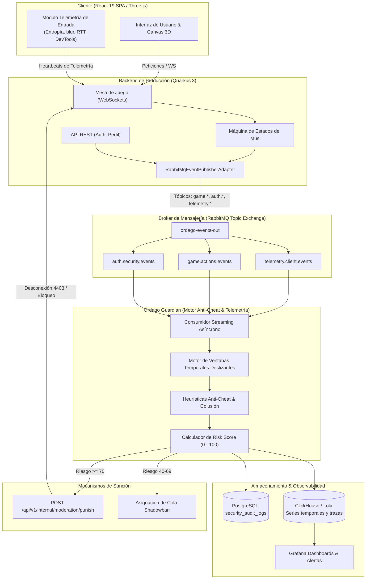

# Proyecto a Futuro — Motor de Telemetría de Seguridad, Anti-Cheat y Sanciones Automatizadas (Órdago Guardian)

**Módulo:** Seguridad perimetral, Integridad de juego, Anti-Cheat y Auditoría Forense (`docs/_future/`)  
**Estado:** Propuesta de Arquitectura y Especificación Técnica para Futuras Versiones (v1.x / v2.0)  
**Tecnología Propuesta:** Microservicio / Worker en Go o Rust consumidor de RabbitMQ + Persistencia en PostgreSQL / ClickHouse + Dashboard en Grafana / Loki.

---

## 1. Visión General y Motivación

En un juego competitivo como **Órdago** (donde confluyen ELO competitivo, psicología de mesa, mecánicas de foco visual y señas interceptables, y eventual economía de cosméticos/torneos), la integridad del juego es un pilar existencial.

### El Dilema del Backend Monolítico vs. Motor Dedicado
1. **Protección del Bucle de Juego en Tiempo Real:**
   El backend principal (`apps/backend/` en Quarkus) gestiona salas WebSocket, sincronización de estado de partidas a baja latencia y transacciones financieras/cuenta. Inyectar cálculos estadísticos pesados (análisis de entropía de ratón, correlación de grafos de colusión o minería de patrones de juego) en el mismo hilo de ejecución degradaría los tiempos de respuesta y aumentaría la latencia de las partidas.
2. **Separación de Responsabilidades (Streaming de Eventos):**
   Quarkus se limita a actuar como **emisor ciego de eventos de dominio** hacia RabbitMQ (`ordago-events-out`). Un motor independiente (**Órdago Guardian**) procesa estos flujos de forma asíncrona, calcula puntuaciones de riesgo (*Risk Score*) y reacciona de manera proactiva.
3. **Resiliencia Operativa:**
   Una saturación o fallo en los algoritmos de detección de trampas jamás interrumpe la continuidad operativa de las partidas activas ni los inicios de sesión de usuarios legítimos.

---

## 2. Diagrama de Arquitectura y Flujo de Detección



---

## 3. Taxonomía Exhaustiva de Monitoreo

El sistema contempla cuatro dimensiones de vigilancia perimetral y de comportamiento:

### A. Capa 1: Telemetría de Navegador / Cliente (Anti-Bot & Tampering)

| Métrica / Telemetría | Frecuencia de Muestreo | Lógica de Detección | Comportamiento Sospechoso / Trampa |
| :--- | :--- | :--- | :--- |
| **Entropía de Micro-movimientos del Ratón** | Cada evento `mousemove` agrupado en buffers de 1s | Muestreo de trayectoria `(x, y, t)` calculando curvatura de Bezier, jitter y aceleraciones. | Clics sintéticos instantáneos, saltos en línea recta o coordenadas idénticas al píxel (Bots/Macros). |
| **Foco y Visibilidad de Pestaña** | En tiempo real (`visibilitychange`, `blur`, `focus`) | Registro de pérdida de visibilidad de la ventana en momentos críticos (ej. turno propio o seña rival). | Uso de herramientas secundarias, dos ventanas abiertas en la misma pantalla o cliente en segundo plano. |
| **Inspección de DevTools y Hooks DOM** | Detección periódica en loop WebWorker | Comprobación de getters de consola, retraso inducido por breakpoints (`debugger`) o modificación de prototipos JS. | Inyección de scripts de tramposos en consola, inspección de memoria de cartas o avatares. |
| **Detección de Entornos Headless / Automatizados** | Al iniciar sesión y en cada reconexión | Comprobación de `navigator.webdriver`, discrepancias entre User-Agent y plugins, WebGL unmasked vendor. | Granjas automatizadas de bots farmeando cuentas o inflando colas de juego. |
| **Canvas & AudioContext Fingerprinting** | Al cargar el lobby | Generación de hash criptográfico único basado en renderizado de Canvas y respuesta espectral de Audio. | Detección de cuentas múltiples y evasión de baneos desde la misma máquina sin importar IPs o cookies. |
| **Fluctuación de Ping y Jitter de Red (RTT)** | Cada 5s mediante pings de WebSocket | Detección de incrementos súbitos y artificiales de RTT justo antes de que expire el temporizador de turno. | *Lag switching* intencional para forzar desconexión y evitar penalizaciones de ELO. |

---

### B. Capa 2: Integridad del Juego y Heurística de Partida (Específico de Mus)

| Comportamiento | Mecanismo de Análisis | Vector de Trampa Detectado |
| :--- | :--- | :--- |
| **Tiempo de Reacción Sobrehumano en Señas** | Comparativa entre `lastSignalTimestamp` y el comando `CATCH_SIGNAL`. | Si un jugador caza una seña en $< 160\text{ ms}$ (límite neurofisiológico humano para estímulo visual y reacción motora), se clasifica como bot que intercepta el evento WebSocket antes de que empiece la animación. |
| **Patrón Mecánico de Escaneo de Foco** | Frecuencia y periodicidad de transiciones entre `CARDS`, `RIVAL_LEFT`, `RIVAL_RIGHT`. | Alternancia milimétrica cíclica (ej. cada 250ms exactos sin varianza humana). Típico de macros de auto-vigilancia. |
| **Detección de Colusión Externa (Discord / Voz)** | Correlación estadística de largo plazo entre compañeros de equipo a lo largo de $\ge 30$ partidas. | La pareja **nunca** ejecuta señas dentro del juego, pero sus descartes y cortes a pares/juego tienen una precisión de manos ocultas del 99.5% incompatible con el azar y la lectura visual. |
| **Multiboxing / Misma IP en Asientos Rivales** | Comprobación cruzada de IPs públicas, rangos CIDR `/24` y canvas fingerprint en la misma mesa. | Un mismo usuario (o cómplices) controlando múltiples asientos para dejarse ganar o forzar derrotas del cuarto jugador. |
| **Win-Trading & ELO Boosting** | Análisis de grafos de emparejamiento y tasas de victoria anómalas. | Jugadores con ELO alto que juegan repetidamente contra cuentas de bajo nivel que abandonan o lanzan órdagos suicidas sin sentido en rondas iniciales. |
| **Inyección de Acciones Ilegales (*Forged Action*)** | Validación estricta en máquina de estados en servidor. | Envío de apuestas superiores al límite legal, acciones fuera de turno o descartes con identificadores de cartas no poseídas en el estado in-memory. |
| **Stalling de Turno (*Griefing*)** | Contador de segundos consumidos por turno sistemáticamente al límite. | Jugador que agota deliberadamente el 98% del tiempo de turno en situaciones de derrota clara para inducir el abandono del rival por aburrimiento. |

---

### C. Capa 3: Autenticación, Credenciales y Ciclo de Vida de Sesión

| Evento de Auditoría | Severidad | Acción Inmediata |
| :--- | :---: | :--- |
| `AUTH_TOKEN_THEFT_DETECTED` | **CRITICAL** | Revocación inmediata de todas las sesiones de la cuenta, invalidación del JWT y emisión de alerta por correo al usuario. |
| `AUTH_IMPOSSIBLE_TRAVEL` | **HIGH** | Logins sucesivos con distancias geográficas incompatibles con la velocidad comercial de transporte ($> 900\text{ km/h}$). Bloqueo temporal y solicitud de verificación. |
| `AUTH_OAUTH_ATO_ATTEMPT` | **HIGH** | Intento de vinculación de proveedor social con email no verificado o discrepancia de Client ID. Rechazo e incremento de contador de sospecha en IP. |
| `AUTH_BRUTE_FORCE_LOCKOUT` | **MEDIUM** | Cuenta bloqueada tras superar el umbral de intentos fallidos con Argon2id (5 intentos en 15 minutos). |
| `PERIMETER_RATE_LIMIT_EXCEEDED`| **MEDIUM** | Saturación continua de endpoints perimetrales (`/login`, `/register`, `/forgot-password`). |
| `PERIMETER_HOUSEKEEPING_UNAUTHORIZED` | **CRITICAL** | Intento de acceso a endpoints de purga interna con clave de API manipulada o nula. Bloqueo inmediato de la IP perimetral. |

---

## 4. Matriz de Decisiones y Respuestas Graduales

Para evitar falsos positivos y dificultar la ingeniería inversa a creadores de trampas, las acciones se gradúan según el **Risk Score (0 a 100)**:

```
Score:  [0 ────────── 39]       [40 ────────── 69]       [70 ────────── 89]       [90 ────────── 100]
Nivel:       BAJO                     MEDIO                    ALTO                    CRÍTICO
Acción:  Modo Silencioso          Shadowban / Hellban      Bloqueo Temporal         Baneo Permanente
```

### Detalle de los Niveles de Sanción:

1. **Nivel 1 — Bajo (Score 10-39 | Sospecha Leve):**
   - Modo silencioso: no se notifica al usuario.
   - Desafíos de verificación pasiva (Cloudflare Turnstile invisible en siguientes peticiones).
   - Suspensión temporal de recompensas estéticas / multiplicadores de ELO.
2. **Nivel 2 — Medio (Score 40-69 | Sospecha Sostenida / Colusión Probable):**
   - **Shadowban (Hellban / Cola oculta de tramposos):**  
     La cuenta puede seguir jugando partidas normales y clasificatorias, pero el motor de *matchmaking* **solo la empareja contra otros jugadores sospechosos o en cuarentena**. Los tramposos juegan entre sí sin contaminar la experiencia de la comunidad legítima.
   - Exclusión de tablas de clasificación públicas (Leaderboards de ELO).
3. **Nivel 3 — Alto (Score 70-89 | Trampa Confirmada en Ejecución):**
   - Expulsión inmediata de la mesa WebSocket con código de cierre `4403 Cheating Detected`.
   - Bloqueo de cuenta temporal (`locked_until = NOW() + 7 DAYS`).
   - Revocación masiva de todas las sesiones activas en `user_sessions`.
4. **Nivel 4 — Crítico (Score 90-100 | Modificación de Cliente / Abuso Reiterado):**
   - Baneo permanente en PostgreSQL (`is_banned = TRUE`, `ban_reason = 'Integrity violation: automated input / collusion'`).
   - Inclusión en lista negra persistente del *Device Fingerprint* y rango de IP.

---

## 5. Esquema de Base de Datos y Persistencia Forense

### Tabla Relacional de Auditoría en PostgreSQL

```sql
-- apps/backend/src/main/resources/db/migration/V1.x__create_security_audit_logs.sql

CREATE TYPE audit_severity AS ENUM ('INFO', 'WARN', 'CRITICAL', 'ALERT');
CREATE TYPE audit_actor_type AS ENUM ('USER', 'GUEST', 'SYSTEM', 'ADMIN', 'ANONYMOUS');

CREATE TABLE security_audit_logs (
    id UUID PRIMARY KEY DEFAULT gen_random_uuid(),
    event_type VARCHAR(64) NOT NULL,
    severity audit_severity NOT NULL DEFAULT 'INFO',
    account_id UUID REFERENCES accounts(id) ON DELETE SET NULL,
    session_id UUID,
    actor_type audit_actor_type NOT NULL DEFAULT 'ANONYMOUS',
    client_ip VARCHAR(45) NOT NULL,
    user_agent VARCHAR(255),
    device_fingerprint VARCHAR(64),
    risk_score INT NOT NULL DEFAULT 0,
    details JSONB NOT NULL DEFAULT '{}'::jsonb,
    created_at TIMESTAMPTZ NOT NULL DEFAULT CURRENT_TIMESTAMP,
    CONSTRAINT chk_audit_risk_score CHECK (risk_score BETWEEN 0 AND 100)
);

-- Índices de consulta rápida
CREATE INDEX idx_security_audit_account ON security_audit_logs(account_id, created_at DESC);
CREATE INDEX idx_security_audit_type ON security_audit_logs(event_type, created_at DESC);
CREATE INDEX idx_security_audit_ip ON security_audit_logs(client_ip, created_at DESC);
CREATE INDEX idx_security_audit_fingerprint ON security_audit_logs(device_fingerprint, created_at DESC);
CREATE INDEX idx_security_audit_high_risk ON security_audit_logs(risk_score DESC) WHERE risk_score >= 70;
```

---

## 6. Contrato de Integración y API de Moderación

El motor de seguridad interactúa con el backend de Quarkus mediante dos contratos desacoplados:

### A. Salida desde Quarkus hacia RabbitMQ
- **Exchange:** `ordago-events-out` (Topic Exchange).
- **Routing Keys:**
  - `auth.security.theft_detected`
  - `auth.security.brute_force`
  - `game.telemetry.reaction_time`
  - `game.telemetry.mouse_entropy`
  - `game.action.caught_signal`
  - `game.action.illegal_state`

### B. Entrada desde el Motor de Seguridad hacia Quarkus (Acción de Sanción)
- **Endpoint Interno:** `POST /api/v1/internal/moderation/punish`
- **Cabecera Requerida:** `X-Housekeeping-Key: <secret_min_32_chars>`
- **Payload JSON:**
```json
{
  "accountId": "a3b8e192-3d44-42f1-bc89-f52981fae412",
  "action": "SHADOWBAN", 
  "reason": "Reaction time anomaly (< 100ms on 4 consecutive caught signals)",
  "durationMinutes": 10080,
  "riskScore": 85,
  "revokeActiveSessions": true,
  "disconnectActiveRooms": true
}
```

---

## 7. Fases de Implementación Sugeridas (Roadmap)

```
[ Fase 1: MVP ]  ─────────►  [ Fase 2: Telemetría ]  ─────────►  [ Fase 3: Guardian Service ]
  - Tabla audit_logs          - Muestreo entropía ratón           - Microservicio Go/Rust
  - Registro de auth y        - Detección reacción < 160ms        - Algoritmos de colusión
    token theft en Postgres   - Alertas en Grafana/Loki           - Cola Shadowban automática
```

1. **Fase 1 (MVP — Actual):**
   - Tabla `security_audit_logs` en PostgreSQL.
   - Servicio ligero `SecurityAuditService` en Quarkus que persiste eventos críticos de autenticación (`TOKEN_THEFT`, `LOCKOUT`, `CLAIM`, `OAUTH_LINK`).
2. **Fase 2 (Detección de Reacción y Telemetría de Cliente):**
   - Registro en servidor de `reactionTimeMs` en cada `CATCH_SIGNAL`. Si es $< 160\text{ ms}$, emitir evento `game.telemetry.reaction_time`.
   - Módulo en frontend de detección de foco de pestaña y emuladores.
3. **Fase 3 (Órdago Guardian — Motor Independiente):**
   - Microservicio dedicado en Go consumidor de RabbitMQ.
   - Implementación de cola oculta de emparejamiento (*Shadowban matchmaking*).
   - Detección de colusión de parejas y minería de grafos de partidas.
