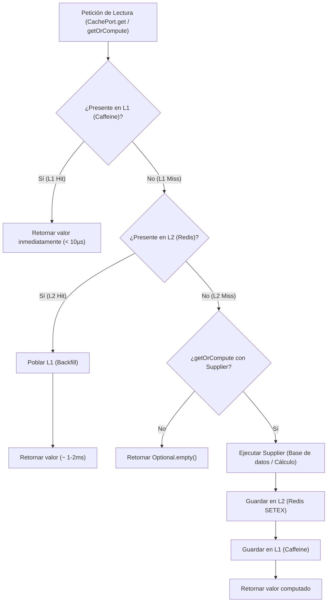

# 05. Technical Specification — Two-Level Cache Architecture (L1 + L2)

**Módulo:** Rendimiento y Persistencia de Caché (`apps/backend/`)  
**Enfoque:** Arquitectura Hexagonal con caché híbrida de dos niveles: L1 (Caffeine en memoria RAM de la JVM) + L2 (Redis 7 distribuido).

---

## 1. Visión General y Objetivos

Para optimizar las lecturas intensivas y garantizar latencias sub-milisegundo sin sobrecargar PostgreSQL, el backend implementa una estrategia de **Two-Level Caching** (caché multinivel coordinada):

1. **Nivel 1 (L1 - Caffeine Cache):**
   - Caché local en memoria RAM dentro de la JVM.
   - Latencia de acceso: **< 10 µs** (sin deserialización ni saltos de red).
   - Control de límites por número máximo de entradas y TTL individual por clave.
2. **Nivel 2 (L2 - Redis Distributed Cache):**
   - Caché compartida y distribuida entre todas las réplicas del backend.
   - Latencia de acceso: **~ 1-3 ms** (red local del clúster).
   - Persistencia de clave-valor con serialización JSON (Jackson) y TTL administrado en Redis (`SETEX`).
3. **Resiliencia & Fail-Safe (Degradación Elegante):**
   - Si Redis no está disponible o sufre timeout de conexión, el sistema atrapa las excepciones, emite advertencias en el log y degrada transparentemente al cómputo/base de datos sin propagar errores al usuario final.

---

## 2. Diagrama de Flujo y Topología



---

## 3. Arquitectura Hexagonal y Componentes

El diseño respeta estrictamente los principios de arquitectura hexagonal del proyecto: el dominio no depende de bibliotecas externas (ni Caffeine, ni Quarkus Redis Client, ni Jackson).

```
apps/backend/src/main/java/dev/ordago/shared/
  ├── domain/port/out/
  │     └── CachePort.java                  # Pure Driven Port (interfaz desacoplada)
  └── infrastructure/cache/
        ├── CacheProperties.java            # Configuración tipada (@ConfigProperty)
        ├── CaffeineL1Cache.java            # Adaptador L1 (Caffeine)
        ├── RedisL2Cache.java               # Adaptador L2 (Quarkus RedisDataSource)
        └── TwoLevelCacheAdapter.java       # Implementación coordinada de CachePort
```

### Contrato del Puerto (`CachePort`)

[`CachePort`](file:///home/jorge/.personal/musgames/apps/backend/src/main/java/dev/ordago/shared/domain/port/out/CachePort.java) define las operaciones esenciales de caché disponibles para los servicios de aplicación:

```java
public interface CachePort {
    <T> Optional<T> get(String key, Class<T> type);
    <T> T getOrCompute(String key, Class<T> type, Supplier<T> supplier, Duration l1Ttl, Duration l2Ttl);
    <T> T getOrCompute(String key, Class<T> type, Supplier<T> supplier);
    void put(String key, Object value, Duration l1Ttl, Duration l2Ttl);
    void put(String key, Object value);
    void evict(String key);
    void evictAll();
    boolean exists(String key);
}
```

---

## 4. Estrategia de Coordinación e Invalidación

### A. Lecturas (`get` / `getOrCompute`)
- **L1 Hit:** Retorna el objeto directamente desde la memoria RAM. Redis no recibe tráfico.
- **L1 Miss / L2 Hit:** Redis devuelve el JSON, Jackson lo deserializa a la clase tipada y se repuebla automáticamente L1 con el TTL configurado. Siguientes lecturas se resuelven en L1.
- **Doble Miss con `getOrCompute`:** Se evalúa la función `Supplier<T>`. Si produce un valor no nulo, se almacena en L2 (con su TTL distribuido) y en L1 (con su TTL local).

### B. Escrituras e Invalidación (`put` / `evict` / `evictAll`)
- `put`: Escribe sincrónicamente en L2 (Redis) y en L1 (Caffeine).
- `evict`: Invalida la entrada tanto en la memoria de L1 como en Redis (`DEL ordago:cache:<key>`).
- `evictAll`: Limpia por completo la instancia local L1 e invoca un escaneo por prefijo (`ordago:cache:*`) para eliminar las claves administradas en Redis.

---

## 5. Configuración de Entorno y Propiedades

Las propiedades de configuración residen en [application.properties](file:///home/jorge/.personal/musgames/apps/backend/src/main/resources/application.properties):

| Propiedad | Valor por Defecto | Descripción |
| :--- | :--- | :--- |
| `quarkus.redis.hosts` | `redis://${REDIS_HOST:localhost}:${REDIS_PORT:6379}` | URI de conexión al servidor Redis. |
| `ordago.cache.l1.max-size` | `10000` | Límite máximo de elementos en memoria JVM para evitar OOM. |
| `ordago.cache.l1.default-ttl-seconds` | `300` (5 min) | Tiempo de vida predeterminado para entradas en L1. |
| `ordago.cache.l2.default-ttl-seconds` | `3600` (1 hora) | Tiempo de vida predeterminado para entradas en L2. |
| `ordago.cache.l2.key-prefix` | `ordago:cache:` | Prefijo para aislamiento y namespace en Redis. |

### Configuración en Docker Compose

- **Desarrollo ([docker/dev/compose.yaml](file:///home/jorge/.personal/musgames/docker/dev/compose.yaml)):**
  - Contenedor `mus-redis-dev` (`redis:7-alpine`).
  - Puerto expuesto a host: `127.0.0.1:${REDIS_PORT:-6379}:6379`.
  - Healthcheck activo: `["CMD", "redis-cli", "ping"]`.
- **Producción ([docker/prod/compose.yaml](file:///home/jorge/.personal/musgames/docker/prod/compose.yaml)):**
  - Contenedor `mus-redis-prod` (`redis:7-alpine`).
  - **Seguridad:** Sin exposición de puertos hacia el exterior/host; accesible únicamente desde la red interna `mus-network`.
  - Límites de recursos: `cpus: '1.0'`, `memory: 512M`.

---

## 6. Estrategia de Pruebas Unitarias (Testing)

Los tests de la infraestructura de caché se encuentran en [`apps/backend/src/test/java/dev/ordago/shared/infrastructure/cache/`](file:///home/jorge/.personal/musgames/apps/backend/src/test/java/dev/ordago/shared/infrastructure/cache/):

- **Sin contenedores pesados:** Se desactiva Redis DevServices (`%test.quarkus.redis.devservices.enabled=false`) en modo test para evitar arrancar contenedores Docker innecesarios en la suite unitaria.
- **Test Doubles Ligeros:** Mediante dynamic proxies de Java (`java.lang.reflect.Proxy`), se simulan las operaciones de `ValueCommands` y `KeyCommands` de Quarkus Redis Client.
- **Casos de prueba cubiertos (46 tests unitarios):**
  - Mapeo y validaciones de configuración (`CachePropertiesTest`).
  - L1 Caffeine: TTLs por clave, TTLs negativos/cero (fallback), desajuste de tipos de datos, desalojo (`CaffeineL1CacheTest`).
  - L2 Redis: Serialización Jackson, gestión de TTLs (`SETEX`), tolerancia a fallos ante desconexión o JSON corrupto (`RedisL2CacheTest`).
  - Coordinación de Niveles: Promoción de L2 a L1, doble miss con cómputo de supplier, coherencia de invalidación (`TwoLevelCacheAdapterTest`).

---

## 7. Guía de Uso para Casos de Uso

Para utilizar la caché en cualquier caso de uso de aplicación, inyectar la interfaz de puerto:

```java
@ApplicationScoped
public class GetUserProfileUseCaseImpl implements GetUserProfileUseCase {

    private final UserProfileRepositoryPort repositoryPort;
    private final CachePort cache;

    @Inject
    public GetUserProfileUseCaseImpl(UserProfileRepositoryPort repositoryPort, CachePort cache) {
        this.repositoryPort = repositoryPort;
        this.cache = cache;
    }

    @Override
    public UserProfile execute(UUID userId) {
        String cacheKey = "profile:" + userId;
        return cache.getOrCompute(
                cacheKey,
                UserProfile.class,
                () -> repositoryPort.findById(userId)
                        .orElseThrow(() -> new UserProfileNotFoundException(userId)),
                Duration.ofMinutes(5),  // L1 TTL (memoria local)
                Duration.ofHours(1)     // L2 TTL (Redis distribuido)
        );
    }
}
```
