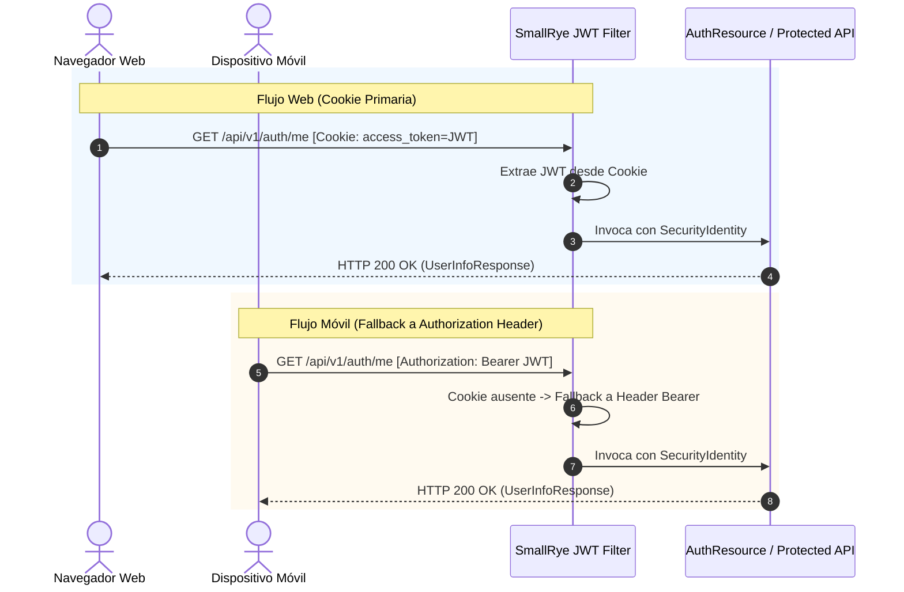

# 06. Technical Specification — Authentication Cookie Transport & Dual-Mode Fallback

**Módulo:** Seguridad y Autenticación (`apps/backend/` + `apps/frontend/`)  
**Enfoque:** Arquitectura Dual de Transporte de Tokens: Cookies Seguras (`HttpOnly`, `SameSite=Strict`, `Secure`) para Clientes Web / SPA + Fallback en Body / Header para Dispositivos Móviles y Clientes Externos.

---

## 1. Visión General y Objetivos

Para proteger la plataforma frente a vulnerabilidades críticas de cliente como **Cross-Site Scripting (XSS)** y **Cross-Site Request Forgery (CSRF)**, el sistema evoluciona de un modelo donde los tokens residían exclusivamente en el payload JSON a un **modelo dual de transporte**:

1. **Clientes Web / SPA (Navegadores):**
   - Los tokens no son accesibles mediante JavaScript (`document.cookie`), mitigando la exfiltración masiva de credenciales ante inyecciones XSS.
   - Las cookies de sesión se marcan con `SameSite=Strict`, garantizando que el navegador nunca las adjunte en peticiones originadas desde sitios externos (protección nativa contra CSRF).
   - En producción, el flag `Secure` asegura que las cookies solo se transmitan sobre canales cifrados TLS (`https://`).
2. **Dispositivos Móviles y Clientes API (No Navegadores):**
   - Las respuestas de autenticación (`/login`, `/register`, `/refresh`) continúan incluyendo los tokens en el cuerpo de la respuesta (`AuthResponse`, `TokenResponse`).
   - Los clientes nativos o APIs externas pueden seguir utilizando la cabecera estándar `Authorization: Bearer <token>` y enviar el `refreshToken` en el cuerpo JSON de forma transparente.

---

## 2. Especificación de Cookies

| Cookie | Ámbito (`Path`) | Tiempo de Vida (`Max-Age`) | Flags | Propósito |
| :--- | :--- | :--- | :--- | :--- |
| `access_token` | `/` | 900 segundos (15 min) | `HttpOnly; SameSite=Strict; Secure` | Autorización de peticiones REST y WebSockets en toda la plataforma. |
| `refresh_token` | `/api/v1/auth` | 2.592.000 segundos (30 días) | `HttpOnly; SameSite=Strict; Secure` | Rotación de credenciales. Su path restringido evita que se envíe en llamadas a `/api/v1/profile`, `/ws/*`, etc. |

> [!NOTE]
> En entornos de desarrollo y pruebas (`dev`, `test`), `ordago.auth.cookie.secure` se establece en `false` para permitir pruebas sobre `http://localhost`. En el perfil de producción (`%prod`), se fuerza `true`.

---

## 3. Diagramas de Flujo y Secuencia

### A. Autenticación (`/login` o `/register`)

```mermaid
sequenceDiagram
    autonumber
    actor Cliente as Navegador Web / Móvil
    participant AuthAPI as AuthResource
    participant Service as AuthService
    participant CookieSvc as AuthCookieService

    Cliente->>AuthAPI: POST /api/v1/auth/login (email, password)
    AuthAPI->>Service: login(command)
    Service-->>AuthAPI: AuthResult(tokens, user, session)
    
    AuthAPI->>CookieSvc: createAccessTokenCookie(accessToken, expiresIn)
    AuthAPI->>CookieSvc: createRefreshTokenCookie(refreshToken, duration)
    
    AuthAPI-->>Cliente: HTTP 200 OK<br/>Set-Cookie: access_token=...; HttpOnly; SameSite=Strict<br/>Set-Cookie: refresh_token=...; Path=/api/v1/auth; HttpOnly; SameSite=Strict<br/>Body: { accessToken, refreshToken, user, ... }
    Note over Cliente: Navegador: almacena cookies HttpOnly.<br/>Móvil: extrae tokens del cuerpo.
```

---

### B. Petición Autenticada con Fallback (`/me`, endpoints protegidos)

SmallRye JWT está configurado para inspeccionar en primer lugar la cookie `access_token`. Si la cookie no está presente, se activa el fallback a la cabecera `Authorization: Bearer <token>`:



---

### C. Rotación de Token (`/refresh`) y Cierre de Sesión (`/logout`)

- **`/refresh`:**
  - Extrae el token de refresco evaluando prioritariamente la cookie `@CookieParam("refresh_token")`.
  - Si la cookie no existe, utiliza `request.refreshToken()` del cuerpo JSON.
  - Al rotar el token, emite nuevas cookies `Set-Cookie` actualizadas y devuelve `TokenResponse` en el body.
- **`/logout` y `/change-password`:**
  - Invalida la sesión activa o especificada en base de datos.
  - Emite cookies con `Max-Age=0` y valor vacío para ordenar al navegador su destrucción inmediata.

```mermaid
sequenceDiagram
    autonumber
    actor Cliente as Cliente Web / Móvil
    participant AuthAPI as AuthResource
    participant Service as AuthService
    participant CookieSvc as AuthCookieService

    Cliente->>AuthAPI: POST /api/v1/auth/logout [Cookie o Body]
    AuthAPI->>Service: logout(command)
    AuthAPI->>CookieSvc: clearAccessTokenCookie()
    AuthAPI->>CookieSvc: clearRefreshTokenCookie()
    AuthAPI-->>Cliente: HTTP 204 No Content<br/>Set-Cookie: access_token=; Max-Age=0; Path=/<br/>Set-Cookie: refresh_token=; Max-Age=0; Path=/api/v1/auth
```

---

## 4. Configuración en Quarkus (`application.properties`)

```properties
# SmallRye JWT: Extracción primaria por Cookie con Fallback a Header
mp.jwt.token.header=Cookie
mp.jwt.token.cookie=access_token
smallrye.jwt.always-check-authorization=true

# Configuración de Seguridad de Cookies de Órdago
ordago.auth.cookie.secure=false
%prod.ordago.auth.cookie.secure=true
ordago.auth.cookie.same-site=STRICT

# Habilitación de Cookies en Cross-Origin (CORS)
quarkus.http.cors=true
quarkus.http.cors.origins=${CORS_ALLOWED_ORIGINS:http://localhost:3000,http://localhost:5173}
quarkus.http.cors.headers=accept, authorization, content-type, x-requested-with, accept-language
quarkus.http.cors.methods=GET, POST, PUT, DELETE, OPTIONS
quarkus.http.cors.access-control-allow-credentials=true
```

---

## 5. Integración en el Cliente Frontend (`apps/frontend/`)

El cliente HTTP (`httpClient.ts`) invoca la API nativa `fetch` con `credentials: 'include'` por defecto:

```typescript
// apps/frontend/src/core/infrastructure/api/httpClient.ts
response = await fetch(url, {
  credentials: restOptions.credentials ?? 'include',
  ...restOptions,
  body: requestBody,
  headers,
})
```

Esto garantiza que:
1. El navegador envíe automáticamente las cookies en peticiones tanto de mismo origen como cruzadas entre el servidor de desarrollo (`http://localhost:5173`) y el backend (`http://localhost:8080`).
2. Las cabeceras `Set-Cookie` sean procesadas y almacenadas de forma segura por el motor del navegador.
