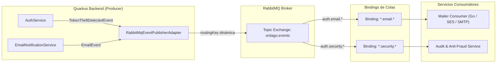

# 07. Technical Specification — RabbitMQ Topic Exchange & Dynamic Routing Keys

**Módulo:** Mensajería Asíncrona y Event-Driven Architecture (`apps/backend/`)  
**Enfoque:** Publicación de eventos de dominio reactivos con claves de enrutamiento dinámicas en un Topic Exchange de RabbitMQ (`ordago.events`), permitiendo subscripciones desacopladas y selectivas para microservicios especializados (Mailer, Auditoría de Seguridad, etc.).

---

## 1. Visión General y Objetivos

El sistema de mensajería asíncrona de Órdago evoluciona de un modelo de clave fija (`default-routing-key=ordago.event`) a un **Topic Exchange dinámico y jerárquico**:

1. **Eliminación del Acoplamiento Monolítico:**
   - La clave estática `ordago.event` obligaba a todos los consumidores a recibir todos los eventos sin distinción o a filtrarlos en código de aplicación tras su consumo.
   - Con routing keys semánticas, RabbitMQ filtra los mensajes a nivel de broker mediante colas y bindings dedicados.
2. **Subscripción Desacoplada y Selectiva:**
   - **Microservicio de Correo (`apps/mailer`):** Consume únicamente los eventos que requieren envío de email vinculándose con el patrón `auth.email.*` o `*.email.*`.
   - **Servicio de Auditoría y Seguridad:** Consume eventos de seguridad e intrusión vinculándose con `auth.security.*` o `*.security.*`.
3. **Resiliencia y Sanitización:**
   - Sanitización automática de claves para cumplir estrictamente con el estándar AMQP (límite de 255 caracteres, caracteres permitidos `[a-zA-Z0-9_.-]`).
   - Confirmaciones reactivas de entrega (`ack` / `nack`) con registro estructurado y sin fuga de datos sensibles.

---

## 2. Topología de Enrutamiento y Jerarquía de Claves

### Taxonomía de Claves (`<dominio>.<categoría>.<acción>`)

| Routing Key | Evento de Dominio | Consumidores Objetivo | Propósito |
| :--- | :--- | :--- | :--- |
| `auth.email.verification` | `EmailEvent` (template: `email-verification`) | Mailer Microservice | Envío de correo con enlace de verificación de cuenta de nuevo usuario. |
| `auth.email.password_reset` | `EmailEvent` (template: `password-reset`) | Mailer Microservice | Envío de correo con token de recuperación de contraseña. |
| `auth.email.welcome` | `EmailEvent` (template: `welcome`) | Mailer Microservice | Envío de bienvenida e introducción al juego tras verificación o alta. |
| `notification.email.<tipo>` | `EmailEvent` (template genérico) | Mailer Microservice | Notificaciones operativas, avisos de mantenimiento, etc. |
| `auth.security.theft_detected` | `TokenTheftDetectedEvent` | Servicio de Auditoría y Fraude | Alerta de intento de reutilización de refresh token previo fuera de la ventana de gracia. |
| `<dominio>.<agregado>.<evento>` | Subclases de `DomainEvent` | Múltiples servicios de dominio | Eventos generales de la aplicación (ej. `room.mus.created`, etc.). |

---

## 3. Diagrama de Enrutamiento Topic



---

## 4. Componentes de la Arquitectura

### A. Contrato `DomainEvent` con Routing Key Dinámica
En `dev.ordago.shared.domain.event.DomainEvent`, cada evento declara su propia clave o utiliza su tipo de evento por defecto:

```java
public interface DomainEvent {
    UUID eventId();
    String eventType();
    Instant occurredOn();
    String aggregateId();

    default String routingKey() {
        return eventType();
    }
}
```

### B. Mapeo Semántico en `EmailEvent`
En `dev.ordago.notification.domain.model.EmailEvent`, el método `routingKey()` resuelve dinámicamente la clave a partir del template del mensaje:

```java
@Override
public String routingKey() {
    return switch (template) {
        case "email-verification" -> "auth.email.verification";
        case "password-reset" -> "auth.email.password_reset";
        case "welcome" -> "auth.email.welcome";
        default -> "notification.email." + template.replace('-', '_');
    };
}
```

### C. Evento de Detección de Robo de Token (`TokenTheftDetectedEvent`)
Ubicado en `dev.ordago.auth.domain.event.TokenTheftDetectedEvent`:
- Es un `record` inmutable que encapsula metadatos forenses (`accountId`, `sessionId`, `deviceId`, `deviceName`, `clientIp`).
- **Privacidad y Seguridad:** No contiene contraseñas, hashes Argon2id ni tokens de refresco en claro.
- Su `routingKey()` retorna `"auth.security.theft_detected"`.

### D. Adaptador de Publicación Reactiva (`RabbitMqEventPublisherAdapter`)
El adaptador inyecta los metadatos de enrutamiento AMQP mediante `OutgoingRabbitMQMetadata`:

```java
String rawKey = event.routingKey();
if (rawKey == null || rawKey.isBlank()) {
    rawKey = (event.eventType() != null && !event.eventType().isBlank()) 
            ? event.eventType() 
            : "ordago.event";
}
String sanitizedKey = rawKey.trim().replaceAll("[^a-zA-Z0-9_.-]", "_");
if (sanitizedKey.length() > 255) {
    sanitizedKey = sanitizedKey.substring(0, 255);
}

Instant occurredOn = event.occurredOn() != null ? event.occurredOn() : Instant.now();
OutgoingRabbitMQMetadata metadata = new OutgoingRabbitMQMetadata.Builder()
        .withRoutingKey(sanitizedKey)
        .withTimestamp(ZonedDateTime.ofInstant(occurredOn, ZoneOffset.UTC))
        .build();

Message<String> message = Message.of(payload, Metadata.of(metadata))
        .withAck(() -> {
            LOG.debugf("Event acknowledged by RabbitMQ [eventId=%s, routingKey=%s]", event.eventId(), sanitizedKey);
            return CompletableFuture.completedFuture(null);
        })
        .withNack(throwable -> {
            LOG.errorf(throwable, "Event delivery failed [eventId=%s, routingKey=%s]", event.eventId(), sanitizedKey);
            return CompletableFuture.completedFuture(null);
        });

emitter.send(message);
```

---

## 5. Garantías Transaccionales y de Seguridad en `AuthService`

Para evitar que el lanzamiento de excepciones de dominio provoque un rollback en la base de datos que invalide el registro de la revocación:

1. **`refreshToken`:** Declarado con `@Transactional(dontRollbackOn = SessionRevokedException.class)`. Al detectar reutilización ilegítima fuera de la ventana de gracia de 30 segundos, el evento `TokenTheftDetectedEvent` se publica en RabbitMQ, la sesión se marca como revocada (`is_revoked = true`, motivo: `TOKEN_THEFT_DETECTED`) y se persiste definitivamente en PostgreSQL antes de rechazar la petición con código HTTP 401.
2. **`login`:** Declarado con `@Transactional(dontRollbackOn = InvalidCredentialsException.class)`. Permite persistir el incremento en el contador de intentos fallidos (`failed_login_attempts`) y el timestamp de bloqueo temporal (`locked_until`) ante ataques de fuerza bruta.
