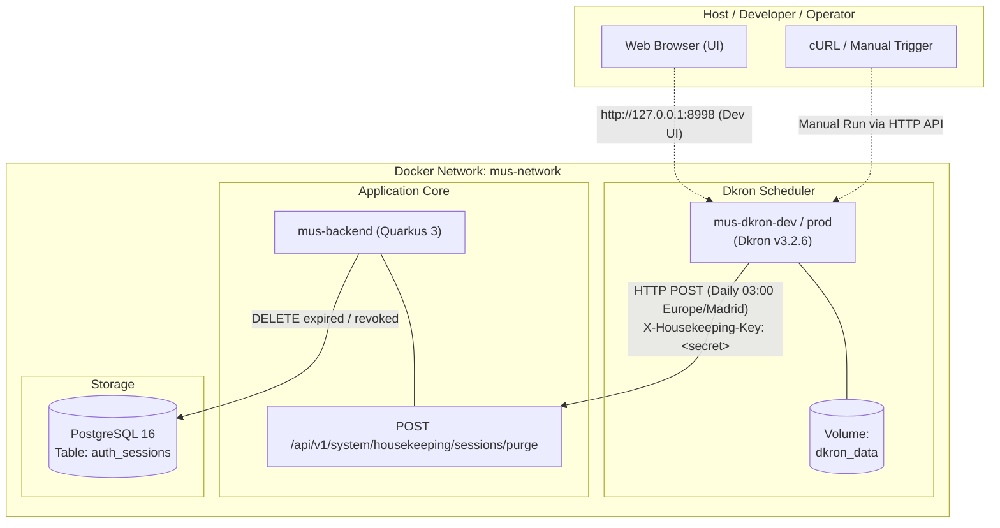
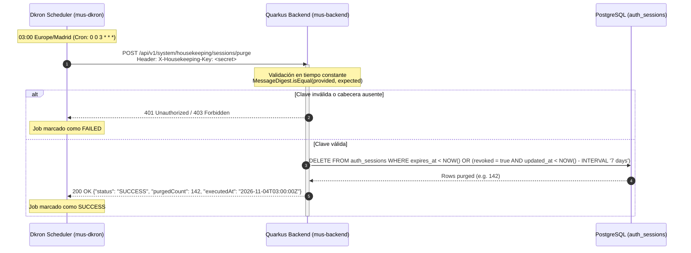

# 08. Technical Specification — Automated Session Housekeeping & Dkron Distributed Scheduler

**Módulo:** Infraestructura, DevOps y Ciclo de Vida de Sesiones (`docker/`, `apps/backend/`)  
**Enfoque:** Automatización del purgado programado de sesiones revocadas y expiradas en PostgreSQL mediante el planificador distribuido Dkron, securizado a través de cabeceras de red interna y secretos precompartidos.

---

## 1. Visión General y Motivación

En la arquitectura de autenticación de Órdago, cada inicio de sesión exitoso (`/api/v1/auth/login`, `/register`) crea un registro de sesión persistente con rotación criptográfica de refresh tokens (duración máxima de 30 días) y revocación inmediata en eventos de cierre de sesión (`/logout`) o detección de reutilización fraudulenta (*token theft detection*).

### El Problema: Crecimiento No Acotado (*Unbounded Growth*)
Sin un mecanismo periódico de limpieza:
1. **Degradación de Índices:** Tablas críticas como `auth_sessions` acumulan millones de filas muertas o inválidas, degradando los árboles B-Tree de índices clave (`idx_auth_sessions_user_id`, `idx_auth_sessions_token_hash`).
2. **Desperdicio de Almacenamiento y Caché:** El tamaño en disco y los buffers de memoria de PostgreSQL (`shared_buffers`) se saturan con sesiones obsoletas.
3. **Sobrecarga de Backups y Replicación:** Las copias de seguridad incrementales y el tráfico WAL (*Write-Ahead Logging*) transportan datos sin valor operativo.

### Desacoplamiento Arquitectónico (Dkron vs. In-Process Scheduler)
En lugar de embeber un planificador en memoria dentro del backend (como `@Scheduled` de Quarkus o Quartz con tablas de base de datos):
- **Escalabilidad Horizontal:** Si el backend escala a múltiples pods o réplicas en clúster, un temporizador interno generaría ejecuciones concurrentes o requeriría mecanismos pesados de bloqueo distribuido.
- **Ciclo de Vida Independiente:** El reinicio, redesciegue o compilación en caliente del backend no interrumpe el planificador de tareas programadas del sistema.
- **Separación de Responsabilidades:** El backend expone un endpoint REST idempotente de mantenimiento transaccional; el planificador externo (**Dkron**) gestiona la temporización, concurrencia, reintentos y auditoría de ejecuciones.

---

## 2. Diagramas de Arquitectura y Secuencia

### Diagrama de Topología en Red Docker (`mus-network`)



### Diagrama de Secuencia de la Tarea Programada



---

## 3. Modelo de Seguridad

El endpoint de purgado de sesiones ejecuta operaciones destructivas a gran escala en la base de datos de usuarios. Su protección se basa en una arquitectura de defensa en profundidad:

### 1. Aislamiento de Red
- En entornos de producción (`docker/prod/compose.yaml`), el servicio Dkron y los endpoints de gestión internos no publican puertos hacia interfaces públicas.
- El tráfico ocurre estrictamente sobre la red puente interna `mus-network`, inaccesible desde el perímetro exterior.

### 2. Autenticación por Secreto Precompartido (`X-Housekeeping-Key`)
- El backend exige la presencia de la cabecera HTTP:
  ```http
  X-Housekeeping-Key: <secreto-criptográfico>
  ```
- El valor proviene de la variable de entorno `HOUSEKEEPING_API_KEY`, sincronizada de forma segura entre el contenedor de Dkron y el contenedor del backend.
- En producción, si `HOUSEKEEPING_API_KEY` no está definida, Compose bloquea el arranque (`"${HOUSEKEEPING_API_KEY:?HOUSEKEEPING_API_KEY environment variable must be set in production}"`).

### 3. Mitigación de Ataques de Temporización (*Timing Attacks*)
- Para prevenir ataques de canal lateral orientados a adivinar el secreto carácter a carácter mediante variaciones de tiempo de respuesta, la comparación en el backend se realiza en tiempo constante:
  ```java
  MessageDigest.isEqual(
      providedKey.getBytes(StandardCharsets.UTF_8),
      configuredKey.getBytes(StandardCharsets.UTF_8)
  );
  ```

---

## 4. Especificación del Job de Dkron

El archivo `docker/dev/dkron/session-housekeeping-job.json` define la tarea distribuida con idempotencia y seguridad:

```json
{
  "name": "session-housekeeping-purge",
  "schedule": "0 0 3 * * *",
  "timezone": "Europe/Madrid",
  "concurrency": "forbid",
  "executor": "http",
  "executor_config": {
    "method": "POST",
    "url": "http://backend:8080/api/v1/system/housekeeping/sessions/purge",
    "headers": "[\"X-Housekeeping-Key: ${HOUSEKEEPING_API_KEY:-ordago-dev-housekeeping-secret-key-32chars}\", \"Content-Type: application/json\"]",
    "timeout": "60s"
  }
}
```

### Parámetros de Configuración

| Propiedad | Valor | Justificación Operativa |
| :--- | :--- | :--- |
| `name` | `session-housekeeping-purge` | Identificador único del job en el clúster de Dkron. |
| `schedule` | `0 0 3 * * *` | Expresión cron de 6 campos (segundos, minutos, horas, día mes, mes, día semana). Ejecuta a las 03:00:00 AM diariamente, en la ventana de menor concurrencia de partidas. |
| `timezone` | `Europe/Madrid` | Garantiza que la hora de ejecución respete los cambios estacionales de horario (CET / CEST). |
| `concurrency` | `forbid` | Previene ejecuciones solapadas si un barrido de base de datos tarda más de lo previsto. Si un job está en ejecución a la hora programada, la nueva ejecución se omite. |
| `executor` | `http` | Plugin de ejecución HTTP integrado nativamente en Dkron v3. |
| `method` | `POST` | Operación mutativa de mantenimiento. |
| `url` | `http://backend:8080/api/v1/system/housekeeping/sessions/purge` | Resolución directa DNS en `mus-network`. |
| `headers` | Array serializado JSON | Inyección de la cabecera `X-Housekeeping-Key` y `Content-Type: application/json`. |
| `timeout` | `60s` | Margen suficiente para operaciones de eliminación por lotes antes de abortar la conexión HTTP. |

---

## 5. Configuración de Contenedores y Orquestación

### Entorno de Desarrollo (`docker/dev/compose.yaml`)

En desarrollo, se despliegan dos contenedores complementarios:
1. **`mus-dkron-dev` (`dkron/dkron:v3.2.6`):**
   - Agente servidor de Dkron con `--bootstrap-expect=1`.
   - Puerto `8998` expuesto en `127.0.0.1` para inspección vía navegador.
   - Volumen `dkron_dev_data` persistiendo `/dkron.data`.
   - Healthcheck nativo verificando `/v1/health` mediante `wget`.
2. **`mus-dkron-init-dev` (`curlimages/curl:8.10.1`):**
   - Contenedor auxiliar ligero de un solo disparo (`restart: "no"`).
   - Depende de que `dkron` esté en estado `service_healthy`.
   - Ejecuta `docker/dev/dkron/init-jobs.sh`, el cual reemplaza dinámicamente el secreto de la variable de entorno y realiza un `POST http://dkron:8998/v1/jobs` de forma completamente idempotente.

### Entorno de Producción (`docker/prod/compose.yaml`)

En producción:
1. **`mus-dkron-prod` (`dkron/dkron:v3.2.6`):**
   - El servicio `dkron` cuenta con `restart: always` y `security_opt: [no-new-privileges:true]`.
   - No se exponen puertos al host (`ports` omitido), garantizando que ni la API ni la interfaz web sean accesibles desde fuera de `mus-network`.
   - El volumen persistente `dkron_prod_data` retiene el estado de los trabajos y el historial de ejecuciones a través de actualizaciones de imagen.
2. **`mus-dkron-init-prod` (`curlimages/curl:8.10.1`):**
   - Contenedor auxiliar de inicialización de un solo disparo (`restart: "no"`, `no-new-privileges:true`).
   - Registra de forma automática e idempotente el job `session-housekeeping-purge` tras el arranque de Dkron, inyectando el valor de `HOUSEKEEPING_API_KEY` definido en producción.
   - No expone puertos y se comunica exclusivamente por la red interna `mus-network`.

---

## 6. Operaciones, Monitoreo y Troubleshooting

### 1. Panel de Control Web (Dkron Dashboard)
En local o desarrollo, abrir:
```
http://localhost:8998
```
Permite verificar:
- Estado del nodo y pertenencia al clúster Raft.
- Lista de trabajos registrados (`session-housekeeping-purge`).
- Próxima fecha programada de disparo (*Next run*).
- Historial de ejecuciones pasadas (*Success* / *Fail*), duración y código de salida HTTP.

### 2. Disparo Manual de Prueba (Trigger On-Demand)

#### A. Disparar el Job a través de Dkron:
```bash
# Disparar la ejecución inmediata a través del planificador
curl -i -X POST http://localhost:8998/v1/jobs/session-housekeeping-purge/run
```

#### B. Disparar directamente el endpoint del Backend:
```bash
# Desde la máquina anfitriona (si BACKEND_PORT=8080 está publicado):
curl -i -X POST http://localhost:8080/api/v1/system/housekeeping/sessions/purge \
  -H "X-Housekeeping-Key: ordago-dev-housekeeping-secret-key-32chars" \
  -H "Content-Type: application/json"
```

### 3. Comprobación del Estado de Salud

```bash
# Comprobar salud del servicio Dkron
curl -s http://localhost:8998/v1/health | jq .
```
Respuesta esperada:
```json
{
  "status": "pass",
  "version": "v3.2.6"
}
```

### 4. Inspección de Registros (*Logs*)

```bash
# Ver logs del planificador
docker compose -f docker/dev/compose.yaml logs -f dkron

# Ver logs del contenedor de inicialización
docker compose -f docker/dev/compose.yaml logs dkron-init

# Ver logs del backend filtrando por mantenimiento
docker compose -f docker/dev/compose.yaml logs -f backend | grep -i housekeeping
```

### 5. Verificación en Base de Datos (PostgreSQL)

Para comprobar el efecto del purgado en la tabla de sesiones:
```bash
docker compose -f docker/dev/compose.yaml exec postgres psql -U mus_user -d mus_db -c \
  "SELECT revoked, COUNT(*), MIN(expires_at), MAX(expires_at) FROM auth_sessions GROUP BY revoked;"
```
