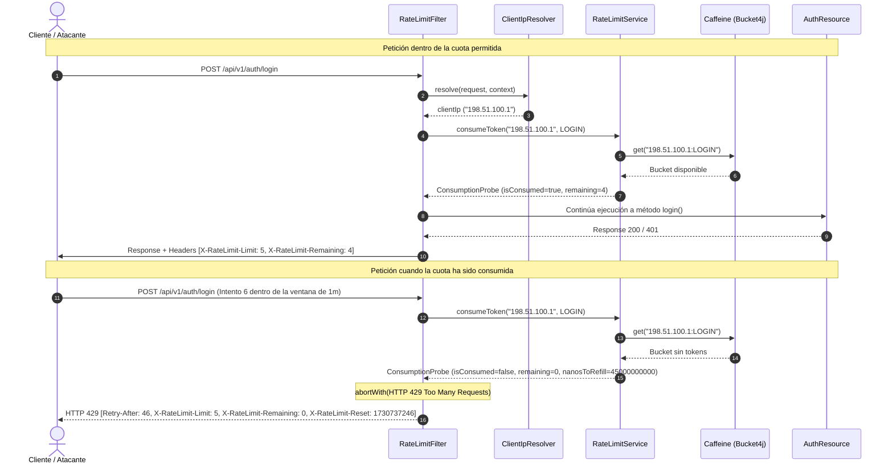

# 09. Technical Specification — Reactive / Interceptor Rate Limiting (Bucket4j + Caffeine)

**Módulo:** Seguridad perimetral, Infraestructura transversal y API REST (`apps/backend/`)  
**Enfoque:** Mitigación de ataques de fuerza bruta (*brute-force*), saturación de credenciales (*credential stuffing*) y denegación de servicio (DoS) en endpoints críticos mediante el algoritmo Token Bucket respaldado por Bucket4j y caché local Caffeine.

---

## 1. Visión General y Motivación

Los endpoints de autenticación y gestión de identidad (`/api/v1/auth/login`, `/register`, `/forgot-password`, `/resend-verification`, `/refresh`) son las superficies más sensibles del sistema frente a:
1. **Ataques de Fuerza Bruta:** Intentos continuos de adivinar contraseñas contra cuentas de usuario específicas.
2. **Credential Stuffing:** Pruebas masivas de pares de email/contraseña filtrados en brechas externas.
3. **Agotamiento de Recursos Criptográficos:** El algoritmo de hashing Argon2id configurado en Órdago (64 MB RAM, 3 iteraciones) demanda un coste computacional elevado de CPU y memoria. Sin limitación temprana a nivel HTTP, ráfagas concurrentes de peticiones maliciosas degradarían el hilo de trabajo del backend.
4. **Abuso de Emisión de Tokens y Correos:** Solicitudes abusivas de restablecimiento de contraseña o reenvió de verificación de correo pueden saturar colas RabbitMQ y agotar cuotas del proveedor transaccional SMTP.

### La Solución: Interceptor Rate Limiting en Capa HTTP
Se implementa un filtro JAX-RS anotado (`RateLimitFilter`) ejecutado con prioridad previa a la autenticación (`Priorities.AUTHENTICATION - 50`):
- Evalúa la tasa de peticiones antes de invocar la lógica de negocio o desencadenar validaciones criptográficas.
- Emplea el algoritmo **Token Bucket** a través de **Bucket4j**, permitiendo ráfagas legítimas acotadas y rellenando tokens a intervalos deterministas.
- Almacena los buckets en memoria en una caché de alto rendimiento **Caffeine** con expiración por inactividad (`expireAfterAccess`) y límite máximo de entradas para garantizar un uso acotado de memoria RAM sin fugas por IPs inactivas.

---

## 2. Diagramas de Arquitectura y Secuencia

### Diagrama de Flujo y Decisión del Filtro

```mermaid
flowchart TD
    Client["Cliente HTTP (Navegador / App)"] --> Ingress["Proxy Inverso / Gateway"]
    Ingress -->|"Petición HTTP + Headers (X-Forwarded-For, X-Real-IP)"| Filter["RateLimitFilter (@Priority 950)"]

    subgraph PerimetralFilter["Inspección Previa a la Autenticación"]
        Filter --> Resolver["ClientIpResolver<br/>(IPv4/IPv6, proxies, sanitización)"]
        Resolver --> TierDet["Detección de Tier<br/>(@RateLimited en Endpoint)"]
        TierDet --> Svc["RateLimitService.consumeToken(clientIp, tier)"]
        
        subgraph MemoryStorage["Almacenamiento en Memoria JVM"]
            Svc --> Cache["Caffeine Cache<br/>(Key: IP + ':' + Tier, Max: 100k, TTL: 15m)"]
            Cache --> Bucket["Bucket4j Token Bucket<br/>(Bandwidth con refillIntervally)"]
        end
    end

    Bucket -->|Token Consumido Exitosamente| Allow["requestContext.proceed()<br/>Inyecta cabeceras X-RateLimit-*"]
    Allow --> Business["AuthResource (Login / Register / etc.)"]
    Business --> ResSuccess["HTTP 200 / 201 / 400 / 401"]

    Bucket -->|Token Denegado (Excedido)| Reject["requestContext.abortWith(HTTP 429)"]
    Reject --> Res429["HTTP 429 Too Many Requests<br/>Retry-After, X-RateLimit-*, ApiError JSON"]
    Res429 --> Client
```

### Diagrama de Secuencia: Petición Aceptada vs. Petición Rechazada (429)



---

## 3. Niveles de Protección (Tiers) y Configuración

Los niveles de limitación se definen mediante el enumerado `RateLimitTier` y son parametrizables a través de `application.properties`:

| Tier | Endpoints Protegidos | Capacidad por Defecto | Duración Ventana | Justificación de Negocio / Seguridad |
| :--- | :--- | :---: | :---: | :--- |
| **`LOGIN`** | `POST /api/v1/auth/login` | 5 peticiones | 1 minuto | Limita intentos de contraseñas por IP; protege CPU ante hashing Argon2id intensivo. |
| **`REGISTER`** | `POST /api/v1/auth/register` | 3 peticiones | 1 minuto | Previene creación masiva automatizada de cuentas bot y agotamiento de player tags. |
| **`PASSWORD_RESET`** | `POST /api/v1/auth/forgot-password` | 3 peticiones | 1 minuto | Protege contra bombardeo de correos (*email spamming*) y abuso del emisor SMTP. |
| **`RESEND_VERIFICATION`** | `POST /api/v1/auth/resend-verification` | 3 peticiones | 1 minuto | Evita saturación de correos de activación hacia casillas de usuarios legítimos. |
| **`REFRESH`** | `POST /api/v1/auth/refresh` | 10 peticiones | 1 minuto | Soporta reconexiones simultáneas de pestañas activas mientras frena ataques de token reuse. |
| **`STANDARD`** | Recursos generales con `@RateLimited` | 60 peticiones | 1 minuto | Protección base para endpoints de lectura o consultas con bajo impacto operativo. |

### Configuración en `application.properties`

```properties
# ------------------------------------------------------------------------------
# Rate Limiting Configuration (Bucket4j + Caffeine)
# ------------------------------------------------------------------------------
ordago.rate-limit.enabled=true
ordago.rate-limit.login.capacity=5
ordago.rate-limit.login.duration-minutes=1
ordago.rate-limit.register.capacity=3
ordago.rate-limit.register.duration-minutes=1
ordago.rate-limit.password-reset.capacity=3
ordago.rate-limit.password-reset.duration-minutes=1
ordago.rate-limit.resend-verification.capacity=3
ordago.rate-limit.resend-verification.duration-minutes=1
ordago.rate-limit.refresh.capacity=10
ordago.rate-limit.refresh.duration-minutes=1
ordago.rate-limit.standard.capacity=60
ordago.rate-limit.standard.duration-minutes=1

# Desactivado en suite general de pruebas para evitar starvation en suites IT funcionales
%test.ordago.rate-limit.enabled=false
```

---

## 4. Mecanismo de Resolución de Dirección IP (`ClientIpResolver`)

Para evitar que clientes maliciosos falsifiquen su dirección IP mediante cabeceras HTTP manipuladas o aprovechen arquitecturas con balanceadores de carga / proxies reversos (Nginx, Traefik, AWS ALB), `ClientIpResolver` implementa la siguiente secuencia de evaluación:

1. **`X-Forwarded-For`:**
   Si la cabecera está presente y no está en blanco, se toma estrictamente el **primer elemento** separado por comas (la IP original del cliente antes del primer proxy de la cadena), recortando espacios en blanco:
   ```java
   String firstIp = forwardedFor.split(",")[0].trim();
   ```
2. **`X-Real-IP`:**
   Si `X-Forwarded-For` no existe o está vacía, se consulta `X-Real-IP`.
3. **`RemoteAddress` (Vert.x Socket):**
   Si ninguna cabecera de proxy está presente, se extrae la dirección host directa de la conexión TCP subyacente (`httpRequest.remoteAddress().host()`).
4. **Fallback Seguro:**
   Si no se puede determinar la dirección, se retorna `"127.0.0.1"`.
5. **Sanitización y Truncado de Longitud:**
   - Soporte para direcciones IPv6 con notación entre corchetes y puerto (ej. `[2001:db8::1]:8080` $\to$ `2001:db8::1`).
   - Soporte para direcciones IPv4 con puerto (ej. `192.168.1.1:8080` $\to$ `192.168.1.1`).
   - Límite estricto de longitud de 45 caracteres (longitud máxima de una dirección IPv6 extendida), evitando ataques de desbordamiento de búfer o inflación de memoria en la clave de la caché.

---

## 5. Estructura de Respuesta HTTP 429 (`Too Many Requests`)

Cuando el consumo de un token es rechazado (`probe.isConsumed() == false`), la petición se cancela inmediatamente devolviendo el código de estado HTTP `429 Too Many Requests` acompañado de cabeceras estándar RFC 6585 / IETF draft y la estructura unificada `ApiError`:

### Cabeceras HTTP Retornadas

| Cabecera | Tipo / Formato | Ejemplo | Descripción |
| :--- | :--- | :--- | :--- |
| `Retry-After` | Entero (segundos) | `45` | Segundos que el cliente debe esperar antes de que el bucket se rellene con al menos 1 token. |
| `X-RateLimit-Limit` | Entero | `5` | Capacidad total de tokens asignada al tier solicitado. |
| `X-RateLimit-Remaining` | Entero | `0` | Tokens restantes en el bucket (0 en respuesta de bloqueo). |
| `X-RateLimit-Reset` | Timestamp Epoch (s) | `1730737245` | Momento Unix absoluto en el que el bucket se restaurará. |
| `Content-Type` | MIME | `application/json` | Formato del cuerpo de error. |

### Cuerpo de Respuesta (`ApiError`)

```json
{
  "success": false,
  "status": 429,
  "error": "Too Many Requests",
  "code": "TOO_MANY_REQUESTS",
  "message": "Rate limit exceeded. Try again in 45 seconds.",
  "path": "/api/v1/auth/login",
  "timestamp": "2026-11-04T15:35:10.123456Z",
  "details": []
}
```

---

## 6. Gestión de Memoria y Rendimiento con Caffeine

El almacenamiento de buckets en memoria utiliza `com.github.benmanes.caffeine.cache.Cache<String, Bucket>`:

```java
Cache<String, Bucket> bucketCache = Caffeine.newBuilder()
        .expireAfterAccess(Duration.ofMinutes(15))
        .maximumSize(100_000)
        .build();
```

- **Clave de Caché:** Cadena con formato `<clientIp>:<Tier>` (ej. `192.0.2.1:LOGIN`).
- **Política de Expiración (`expireAfterAccess` de 15 minutos):** Si una dirección IP cesa su actividad tras realizar peticiones, su bucket se descarta automáticamente de la memoria RAM pasados 15 minutos sin accesos. Esto evita el crecimiento indefinido de la memoria ante escaneos distribuidos o botnets efímeras.
- **Tamaño Máximo (`maximumSize` de 100.000 entradas):** En caso de un ataque de denegación de servicio distribuido (DDoS) masivo con cientos de miles de IPs falsificadas, la caché de Caffeine aplica el algoritmo de reemplazo W-TinyLFU (Window TinyLFU) para mantener el uso de memoria RAM estrictamente acotado y predecible.
- **Eficiencia en CPU:** Las operaciones de lectura y reserva de token en Bucket4j son *lock-free* y atómicas, ejecutándose en fracciones de microsegundos por petición HTTP.

---

## 7. Verificación y Pruebas Automatizadas

El subsistema cuenta con cobertura exhaustiva de pruebas unitarias y de integración:

1. **`ClientIpResolverTest` (Pruebas Unitarias):**
   - Resolución prioritaria de `X-Forwarded-For` tomando la primera IP de listas delimitadas por comas.
   - Fallback a `X-Real-IP` y a `remoteAddress`.
   - Normalización de direcciones IPv4/IPv6, stripping de puertos y truncamiento de longitud a 45 caracteres.
2. **`RateLimitServiceTest` (Pruebas Unitarias):**
   - Consumo progresivo de tokens hasta alcanzar la capacidad máxima y rechazo estricto de peticiones excedentes.
   - Aislamiento total de buckets por dirección IP (la saturación de la IP A no afecta a la IP B).
   - Aislamiento de buckets por tier (la saturación de `LOGIN` no bloquea el endpoint `REGISTER` de la misma IP).
   - Verificación de la bandera `ordago.rate-limit.enabled=false` permitiendo peticiones ilimitadas.
   - Limpieza y reinicio correcto mediante `clearCache()`.
3. **`RateLimitFilterIT` (Pruebas de Integración con RestAssured y `@QuarkusTest`):**
   - Ejecución con `RateLimitEnabledProfile` activando la limitación.
   - Envío de 5 peticiones secuenciales a `/api/v1/auth/login` validando respuestas de credenciales normales (401) y decremento de la cabecera `X-RateLimit-Remaining`.
   - Comprobación de que la 6ª petición es interceptada con HTTP 429, cabecera `Retry-After > 0`, `X-RateLimit-Remaining: 0`, código `TOO_MANY_REQUESTS` en el cuerpo JSON y tiempo de reset.
   - Petición posterior desde una IP alternativa en `X-Forwarded-For` verificando que no sufre bloqueo.
   - Validación cruzada entre tiers comprobando que saturar `LOGIN` permite peticiones a `REGISTER`.
