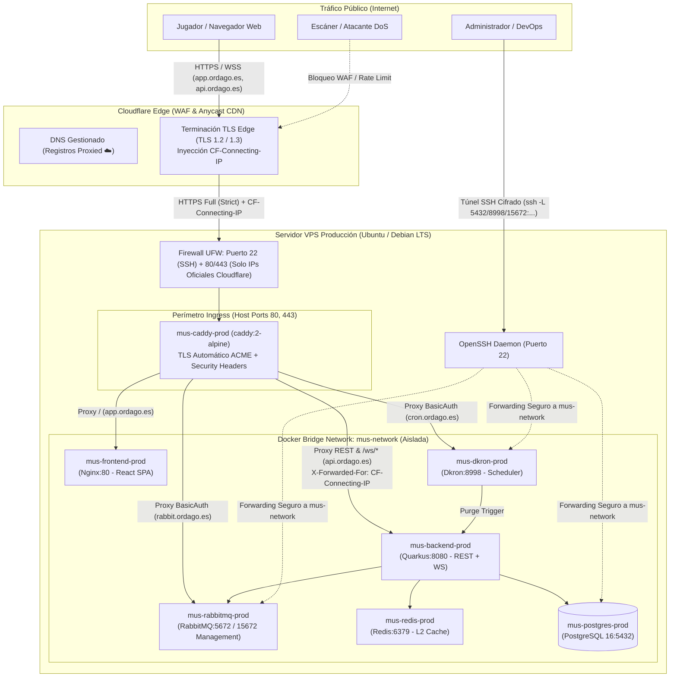
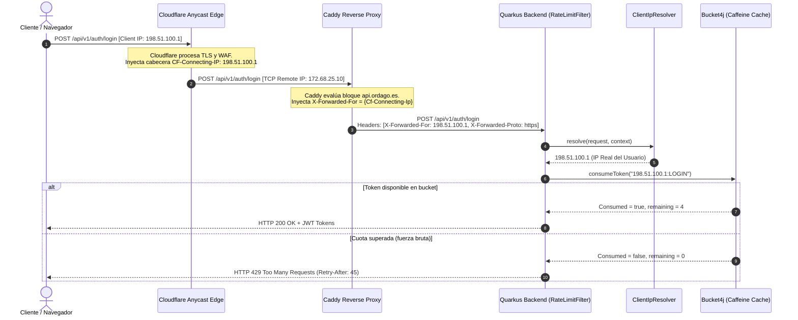

# 10. Technical Specification — Caddy Reverse Proxy, Cloudflare Ingress & VPS Production Deployment

**Módulo:** Infraestructura, Redes, Seguridad Perimetral y Despliegue en Producción (`docker/prod/`, `docs/technical/`)  
**Enfoque:** Configuración del reverse proxy perimetral Caddy v2 con terminación TLS automática, integración con Cloudflare DNS y CDN en modo Full (Strict), aislamiento de red interna Docker (`mus-network`), protección de paneles administrativos con HTTP `basic_auth`, preservación de la IP real del cliente para el limitador de tasa Token Bucket (`ClientIpResolver`), y acceso de mantenimiento a PostgreSQL exclusivamente mediante túnel SSH.

---

## 1. Visión General y Motivación

El despliegue de producción de Órdago (`ordago.es` / `ordago.gg`) requiere un balance estricto entre:
1. **Rendimiento y Cero Fricción:** Soporte nativo de HTTP/2 y HTTP/3 (QUIC) sobre UDP, compresión gzip/zstd, baja latencia en websockets persistentes (`/ws/rooms/{roomId}`) y distribución estática eficiente para la SPA React.
2. **Defensa en Profundidad Perimetral:** Exposición mínima de la superficie de ataque hacia Internet. Los microservicios internos (`backend:8080`, `frontend:80`, `rabbitmq:15672`, `dkron:8998`) residen en una red privada virtual de Docker (`mus-network`) sin mapeo de puertos al host, dejando como único punto de entrada el proxy inverso **Caddy**.
3. **Eficacia del Rate Limiting Reactivo (Bucket4j):** Cuando el tráfico pasa a través de la red global de Cloudflare, la dirección IP a nivel TCP que recibe la VPS pertenece al rango de proxies de Cloudflare. Sin una propagación explícita de `CF-Connecting-IP` hacia el backend mediante `X-Forwarded-For`, el filtro `RateLimitFilter` agruparía a todos los usuarios concurrentes bajo una misma clave de bucket, provocando falsos positivos masivos de HTTP 429 *Too Many Requests*.
4. **Protección de Almacenamiento y Servicios Críticos:** PostgreSQL y Redis no exponen ningún puerto hacia el host ni hacia Internet, bloqueando escaneos automatizados, ataques de fuerza bruta al motor SQL y exploits de red. La administración de la base de datos se delega exclusivamente a túneles SSH autenticados por clave asimétrica.

---

## 2. Diagramas de Arquitectura y Topología de Red

### Diagrama de Topología Perimetral y Red Interna Docker



### Diagrama de Secuencia: Propagación de IP Real e Inspección Rate Limiting



---

## 3. Configuración DNS en Cloudflare

Para que la infraestructura perimetral enrute correctamente el tráfico y aproveche la aceleración Anycast, protección anti-DDoS y gestión de certificados edge, se configuran los registros en la consola de DNS de Cloudflare para la zona de dominio (`{$DOMAIN_NAME}`):

| Nombre / Subdominio | Tipo | Destino / Contenido | Proxy Status | Propósito Operativo |
| :--- | :---: | :--- | :---: | :--- |
| `@` (`ordago.es`) | **A** | `IP_PUBLICA_VPS` | **Proxied** (Nube Naranja) | Dominio apex. Redirige a `app.ordago.es`. |
| `www` | **CNAME** | `ordago.es` | **Proxied** (Nube Naranja) | Subdominio www tradicional. Redirige a `app.ordago.es`. |
| `app` | **CNAME** | `ordago.es` | **Proxied** (Nube Naranja) | Frontend Web SPA (React 19 / Vite / Nginx). |
| `api` | **CNAME** | `ordago.es` | **Proxied** (Nube Naranja) | API REST y WebSockets reactivos (`mus-backend-prod`). |
| `cron` (o `dkron`) | **CNAME** | `ordago.es` | **Proxied** (Nube Naranja) | Panel de administración de Dkron con BasicAuth. |
| `rabbit` | **CNAME** | `ordago.es` | **Proxied** (Nube Naranja) | Panel de administración de RabbitMQ con BasicAuth. |

> [!IMPORTANT]
> Todos los registros deben tener el estado **Proxied** (Nube Naranja) activado. Esto garantiza que la IP real de la VPS nunca quede expuesta en consultas DNS directas, mitigando ataques directos por bypass de CDN.

---

## 4. Configuración SSL/TLS en Cloudflare: Modo Full (Strict)

La seguridad del túnel criptográfico entre el navegador del usuario y el servidor VPS depende del modo de cifrado seleccionado en Cloudflare (**SSL/TLS > Overview**):

```
[Navegador Web] ====== (HTTPS Edge TLS) ======> [Cloudflare Edge] ====== (HTTPS Origin TLS) ======> [Caddy VPS]
```

### ¿Por qué Full (Strict)?

1. **Inseguridad del modo Flexible:**
   En modo *Flexible*, el tráfico entre Cloudflare y la VPS viaja en texto claro (HTTP puerto 80). Un atacante con acceso a la red intermedia del proveedor de VPS o peering puede interceptar contraseñas, tokens JWT y cookies sensibles.
2. **Limitaciones del modo Full (Permisivo):**
   El modo *Full* cifra la conexión de origen pero acepta certificados autofirmados o caducados, lo que permite ataques *Man-in-the-Middle* (MitM) si un atacante suplanta el DNS o la IP del servidor.
3. **Garantías de Full (Strict):**
   Cloudflare exige y valida criptográficamente que la VPS presente un certificado SSL/TLS válido, vigente y firmado por una autoridad certificadora reconocida (como Let's Encrypt o ZeroSSL provistos automáticamente por Caddy a través del desafío ACME HTTP-01/ALPN en el puerto 80/443).

### Parámetros Adicionales en Cloudflare SSL/TLS:
- **Minimum TLS Version:** `TLS 1.2` (deshabilita versiones vulnerables TLS 1.0 y 1.1).
- **HTTP/3 (with QUIC):** Activado.
- **Always Use HTTPS:** Activado en Cloudflare (o gestionado por Caddy).
- **Automatic HTTPS Rewrites:** Activado.
- **WebSockets:** Activado (habilitado por defecto en Cloudflare para todos los planes).

---

## 5. Implementación del Caddyfile (`docker/prod/Caddyfile`)

El archivo de configuración de Caddy v2 adopta una estructura modular y declarativa:

```caddyfile
# ==============================================================================
# Production Caddyfile — Reverse Proxy, TLS & Cloudflare Ingress for Órdago
# ==============================================================================
{
	email {$ACME_EMAIL}
}

# --- Reusable Security Headers Snippet ---
(security_headers) {
	header {
		# Enforce HTTPS across all subdomains with HSTS preload
		Strict-Transport-Security "max-age=31536000; includeSubDomains; preload"
		# Prevent MIME-type sniffing
		X-Content-Type-Options "nosniff"
		# Defend against clickjacking framing attacks
		X-Frame-Options "DENY"
		# Referrer policy to prevent information leakage
		Referrer-Policy "strict-origin-when-cross-origin"
		# Omit Server identification banner (defer strips upstream server headers)
		defer
		-Server
	}
}

# ------------------------------------------------------------------------------
# 1. Apex Domain & WWW: Permanent 308 Redirection to Web App
# ------------------------------------------------------------------------------
{$DOMAIN_NAME}, www.{$DOMAIN_NAME} {
	import security_headers
	redir https://app.{$DOMAIN_NAME}{uri} permanent
}

# ------------------------------------------------------------------------------
# 2. Web Application Frontend (React 19 SPA)
# ------------------------------------------------------------------------------
app.{$DOMAIN_NAME} {
	import security_headers
	reverse_proxy frontend:80
}

# ------------------------------------------------------------------------------
# 3. REST API & Real-time WebSockets (Quarkus 3 Backend)
# ------------------------------------------------------------------------------
api.{$DOMAIN_NAME} {
	import security_headers

	# Reverse proxy to Quarkus backend (handles REST and /ws/* WebSockets natively)
	# CRITICAL: Forward the authentic client IP from Cloudflare's CF-Connecting-IP
	# into X-Forwarded-For so Bucket4j ClientIpResolver correctly enforces rate limits.
	# Fallback to direct client IP if CF-Connecting-IP is absent.
	@hasCf header Cf-Connecting-Ip *
	reverse_proxy backend:8080 {
		header_up @hasCf X-Forwarded-For {http.request.header.Cf-Connecting-Ip}
		header_up !@hasCf X-Forwarded-For {client_ip}
	}
}

# ------------------------------------------------------------------------------
# 4. Administrative Panels (Secured via HTTP Basic Authentication)
# ------------------------------------------------------------------------------

# Dkron Distributed Cron Scheduler Web UI
cron.{$DOMAIN_NAME}, dkron.{$DOMAIN_NAME} {
	import security_headers

	basic_auth {
		{$BASIC_AUTH_USER} {$BASIC_AUTH_HASH}
	}

	reverse_proxy dkron:8998
}

# RabbitMQ Management Web Interface
rabbit.{$DOMAIN_NAME} {
	import security_headers

	basic_auth {
		{$BASIC_AUTH_USER} {$BASIC_AUTH_HASH}
	}

	reverse_proxy rabbitmq:15672
}
```

### Aspectos Clave de la Configuración:
1. **Terminación TLS y HTTP/3 Automáticos:** Caddy gestiona los certificados de Let's Encrypt/ZeroSSL sin intervención manual mediante el bloque global `email {$ACME_EMAIL}`.
2. **Soporte Bidireccional WebSocket:** La directiva `reverse_proxy` de Caddy v2 detecta automáticamente el encabezado `Upgrade: websocket` y mantiene canales dúplex persistentes sin requerir directivas complejas como las de Nginx (`proxy_set_header Upgrade`, `proxy_read_timeout`).
3. **Protección con `basic_auth`:** Los paneles de Dkron y RabbitMQ Management se bloquean en la capa perimetral. Cualquier petición sin credenciales válidas recibe inmediatamente un `HTTP 401 Unauthorized` antes de alcanzar el contenedor de destino.
4. **Supresión de Banners Upstream (`defer -Server`):** Al anteponer `defer` a la directiva `-Server`, Caddy retrasa la eliminación de cabeceras hasta la fase de emisión de respuesta al cliente, asegurando la erradicación total de cabeceras de servidor inyectadas por microservicios upstream (tales como Quarkus o Nginx).
5. **Fallback Condicional de IP Real (`@hasCf`):** Mediante matchers de Caddy v2, se inyecta `CF-Connecting-IP` si el tráfico proviene de Cloudflare, y se aplica fallback automático a `{client_ip}` en caso contrario, garantizando robustez ante llamadas directas o entornos de prueba.

---

## 6. Propagación de IP Real y Token Bucket Rate Limiting

### El Problema de la Máscara de Proxy

En una arquitectura con Cloudflare:
1. El cliente inicia una conexión TCP con una IP pública (`198.51.100.54`).
2. Cloudflare recibe la conexión y realiza una nueva petición HTTP hacia la IP de la VPS de Órdago utilizando una IP de su red interna (por ejemplo, `172.68.25.10` o `162.158.x.x`).
3. Caddy, por omisión, colocaría en la cabecera `X-Forwarded-For` la IP de la conexión TCP entrante (`172.68.25.10`).
4. El backend (`ClientIpResolver.java`) extraería la primera IP de la lista:
   ```java
   String first = forwardedFor.split(",")[0].trim();
   ```
5. Si miles de usuarios comparten la misma IP de Cloudflare, el limitador de tasa `Bucket4j` (`RateLimitFilter`) consumiría los 5 tokens por minuto del tier `LOGIN` para **todos los usuarios del mundo** que pasen por ese nodo de Cloudflare, provocando una denegación de servicio accidental a usuarios legítimos.

### La Solución Implementada: Inyección con Fallback

Cloudflare inyecta de forma inmutable la cabecera `CF-Connecting-IP` con la verdadera dirección IP del cliente remoto.  
En el bloque `api.{$DOMAIN_NAME}` de Caddy, se define un matcher condicional para asignar `CF-Connecting-IP` cuando exista, o recurrir a `{client_ip}` de forma segura:

```caddyfile
@hasCf header Cf-Connecting-Ip *
reverse_proxy backend:8080 {
    header_up @hasCf X-Forwarded-For {http.request.header.Cf-Connecting-Ip}
    header_up !@hasCf X-Forwarded-For {client_ip}
}
```

Esto sustituye la cabecera `X-Forwarded-For` por el valor exacto de `CF-Connecting-IP` (o la IP directa del cliente). De esta manera, `ClientIpResolver` resuelve la IP real del cliente y aísla de forma determinista los buckets de memoria en la caché Caffeine:

```
Bucket Key = "198.51.100.54:LOGIN" (Capacidad: 5 req/min)
Bucket Key = "203.0.113.88:LOGIN" (Capacidad: 5 req/min)
```

---

## 7. Generación de Credenciales Seguras para `basic_auth`

Caddy v2 requiere que las contraseñas para la directiva `basic_auth` se almacenen exclusivamente como hashes criptográficos Bcrypt.

### Comando de Generación

Para generar el hash de la contraseña de administración sin instalar herramientas locales en el host, se ejecuta el contenedor efímero oficial de Caddy:

```bash
docker run --rm caddy:2-alpine caddy hash-password --plaintext 'MiContrasenaSuperSegura2026!'
```

*Salida de ejemplo:*
```
$2a$14$sO0R7yqGeq3XzUeJm.Vf9u1h3ZkV1Z7b3L9K2V7Z8Y6X5W4V3U2T1
```

### Regla Crítica para Docker Compose (`$$` Escaping)

Cuando la variable `BASIC_AUTH_HASH` se define en `.env` o en `compose.yaml`:
- **En `.env` para Docker Compose:** Docker Compose evalúa el símbolo `$` como una variable de entorno. Para evitar que Docker Compose interprete `$2` o `$14` como variables inexistentes y las borre, se debe duplicar el símbolo de dólar (`$$`):
  ```dotenv
  BASIC_AUTH_HASH=$$2a$$14$$sO0R7yqGeq3XzUeJm.Vf9u1h3ZkV1Z7b3L9K2V7Z8Y6X5W4V3U2T1
  ```
- Al leerlo e inyectarlo en el contenedor `caddy`, Caddy recibe el valor desescapado estándar `$2a$14$...` que espera la biblioteca de verificación criptográfica.

---

## 8. Gestión y Acceso a Servicios Internos (PostgreSQL, Dkron, RabbitMQ) Exclusivamente vía Túnel SSH

### Principio de Mínima Superficie de Ataque

En `docker/prod/compose.yaml`, ninguno de los servicios críticos o administrativos expone puertos al host ni a Internet:
- `postgres` (puerto interno 5432)
- `redis` (puerto interno 6379)
- `backend` (puerto interno 8080)
- `dkron` (puerto interno 8998)
- `rabbitmq` (puertos internos 5672 y 15672)

```yaml
  postgres:
    image: postgres:16-alpine
    container_name: mus-postgres-prod
    restart: always
    security_opt:
      - no-new-privileges:true
    # Security: Database port is not published to host in production; accessible only via internal mus-network
    volumes:
      - postgres_prod_data:/var/lib/postgresql/data
    networks:
      - mus-network
```

Ningún escaneo de puertos externo (como Shodan, Censys o Nmap) puede detectar estos puertos. Tampoco existe riesgo de vulnerabilidad por ataques de diccionario, inyecciones directas o vulnerabilidades de red en los motores internos.

### Acceso Administrativo mediante SSH Local Port Forwarding

El operador puede abrir túneles cifrados SSH punto a punto autenticados por clave asimétrica para acceder a cada servicio interno de forma segura:

#### 1. Túnel SSH para Base de Datos PostgreSQL
```bash
ssh -N -L 5432:mus-postgres-prod:5432 usuario@vps_ip
```
- **Conexión SQL Local (`psql`, DBeaver, DataGrip):**
  ```bash
  psql -h 127.0.0.1 -p 5432 -U mus_user -d mus_db
  ```

#### 2. Túnel SSH para Cron Distribuido Dkron Web UI
```bash
ssh -N -L 8998:mus-dkron-prod:8998 usuario@vps_ip
```
- **Acceso Web UI:** Abrir en el navegador local `http://localhost:8998`
- Permite inspeccionar ejecuciones del job `session-housekeeping-daily`, consultar métricas de nodos y lanzar ejecuciones manuales sin exponer el panel a Internet.

#### 3. Túnel SSH para RabbitMQ Management UI
```bash
ssh -N -L 15672:mus-rabbitmq-prod:15672 usuario@vps_ip
```
- **Acceso Web UI:** Abrir en el navegador local `http://localhost:15672`
- Credenciales: Usuario `RABBITMQ_USER` y contraseña `RABBITMQ_PASSWORD` configuradas en `.env`.
- Permite supervisar colas (`email-delivery-queue`), tasas de mensajes por segundo, consumidores Go y dead-letter exchanges de forma totalmente aislada.

#### Desglose de Parámetros del Túnel SSH:
- `-N`: Indica a SSH que no ejecute una shell interactiva remota (mantiene el canal de reenvío de puertos abierto en segundo plano).
- `-L <puerto_local>:<nombre_contenedor_docker>:<puerto_interno>`: Abre el puerto local en la máquina de desarrollo y canaliza el tráfico cifrado hacia el socket del contenedor dentro de la red privada Docker `mus-network` en la VPS. Como el daemon Docker de la VPS resuelve los nombres de contenedores en `mus-network`, el tráfico se encamina directamente a la red interna.
- `usuario@vps_ip`: Conexión al host VPS autenticada estrictamente por par de claves SSH (Ed25519 o RSA 4096) con autenticación por contraseña deshabilitada en `sshd_config`.

### Modo 100% Privado: Desactivación Opcional de Subdominios Públicos

Si la política de seguridad de la organización exige una superficie de ataque pública nula para paneles administrativos:
1. **Omitir Subdominios en Caddyfile:** Es posible comentar o retirar los bloques `cron.{$DOMAIN_NAME}` y `rabbit.{$DOMAIN_NAME}` de `docker/prod/Caddyfile`.
2. **Omitir Registros DNS en Cloudflare:** No dar de alta los subdominios `cron` ni `rabbit` en la zona DNS de Cloudflare.
3. **Administración Exclusiva por Túnel:** Los operadores acceden a Dkron y RabbitMQ exclusivamente a través de los comandos SSH documentados (`http://localhost:8998` y `http://localhost:15672`), garantizando cero exposición web pública hacia Internet.

> [!CAUTION]
> Nunca añada la directiva `ports` a los servicios `postgres`, `redis`, `dkron` o `rabbitmq` en `docker/prod/compose.yaml`. El túnel SSH proporciona confidencialidad punto a punto, autenticación criptográfica robusta y elimina cualquier vector de ataque por exposición involuntaria.

---

## 9. Seguridad Perimetral VPS: Restricción del Cortafuegos UFW a IPs de Cloudflare

### El Riesgo Crítico del Bypass de Cloudflare (Direct IP Origin Discovery)

Si la VPS mantiene abiertos los puertos 80 y 443 a cualquier origen de Internet (`0.0.0.0/0`), el sistema queda expuesto a ataques de bypass de Cloudflare:
1. **Descubrimiento de IP de Origen:** Un atacante puede descubrir la IP pública del servidor VPS mediante rastreo de certificados SSL históricos (Certificate Transparency Logs), escaneo de bloques de red del proveedor cloud (Hetzner, OVH, DigitalOcean, etc.) o cabeceras salientes del servidor.
2. **Evasión de WAF y Rate Limiting:** Al enviar peticiones directamente a la IP pública de la VPS (`https://IP_VPS`), el tráfico no atraviesa la red de Cloudflare, neutralizando las reglas del WAF perimetral, la protección DDoS L7 y la mitigación de bots.
3. **Suplantación de Identidad e IP Spoofing:** Un atacante que contacta directamente a Caddy podría inyectar una cabecera arbitraria `CF-Connecting-IP: <ip_victima>` o `X-Forwarded-For`. Aunque Caddy valide la presencia de la cabecera, no podría distinguir si proviene de un nodo legítimo de Cloudflare o de un atacante directo a menos que el cortafuegos a nivel de red garantice el origen de los paquetes TCP.

### Subredes IP Oficiales de Cloudflare (IPv4 e IPv6)

Cloudflare publica y mantiene su lista oficial de rangos IP en [cloudflare.com/ips](https://www.cloudflare.com/ips/):

**Rangos IPv4:**
- `173.245.48.0/20`
- `103.21.244.0/22`
- `103.22.200.0/22`
- `103.31.4.0/22`
- `141.101.64.0/18`
- `108.162.192.0/18`
- `190.93.240.0/20`
- `188.114.96.0/20`
- `197.234.240.0/22`
- `198.41.128.0/17`
- `162.158.0.0/15`
- `104.16.0.0/13`
- `104.24.0.0/14`
- `172.64.0.0/13`
- `131.0.72.0/22`

**Rangos IPv6:**
- `2400:cb00::/32`
- `2606:4700::/32`
- `2803:f800::/32`
- `2405:b500::/32`
- `2405:8100::/32`
- `2a06:98c0::/29`
- `2c0f:f248::/32`

### Script de Configuración Hardened de UFW

Para aplicar esta restricción de forma determinista e idempotente en el servidor Ubuntu/Debian LTS de producción:

```bash
#!/usr/bin/env bash
set -euo pipefail

echo "=== Configurando Firewall UFW con Hardening Cloudflare ==="

# 1. Restablecer políticas base
sudo ufw default deny incoming
sudo ufw default allow outgoing

# 2. Permitir SSH (Asegúrate de permitir tu puerto SSH antes de habilitar UFW)
sudo ufw allow 22/tcp comment 'SSH Daemon Host'

# 3. Permitir HTTP/HTTPS y HTTP/3 QUIC únicamente desde rangos oficiales de Cloudflare
CLOUDFLARE_IPV4=(
    "173.245.48.0/20"
    "103.21.244.0/22"
    "103.22.200.0/22"
    "103.31.4.0/22"
    "141.101.64.0/18"
    "108.162.192.0/18"
    "190.93.240.0/20"
    "188.114.96.0/20"
    "197.234.240.0/22"
    "198.41.128.0/17"
    "162.158.0.0/15"
    "104.16.0.0/13"
    "104.24.0.0/14"
    "172.64.0.0/13"
    "131.0.72.0/22"
)

for cidr in "${CLOUDFLARE_IPV4[@]}"; do
    sudo ufw allow proto tcp from "$cidr" to any port 80 comment 'Cloudflare IPv4 HTTP'
    sudo ufw allow proto tcp from "$cidr" to any port 443 comment 'Cloudflare IPv4 HTTPS'
    sudo ufw allow proto udp from "$cidr" to any port 443 comment 'Cloudflare IPv4 QUIC'
done

CLOUDFLARE_IPV6=(
    "2400:cb00::/32"
    "2606:4700::/32"
    "2803:f800::/32"
    "2405:b500::/32"
    "2405:8100::/32"
    "2a06:98c0::/29"
    "2c0f:f248::/32"
)

for cidr in "${CLOUDFLARE_IPV6[@]}"; do
    sudo ufw allow proto tcp from "$cidr" to any port 80 comment 'Cloudflare IPv6 HTTP'
    sudo ufw allow proto tcp from "$cidr" to any port 443 comment 'Cloudflare IPv6 HTTPS'
    sudo ufw allow proto udp from "$cidr" to any port 443 comment 'Cloudflare IPv6 QUIC'
done

# 4. Habilitar cortafuegos y verificar reglas activas
sudo ufw --force enable
sudo ufw status numbered
```

> [!TIP]
> Cualquier paquete TCP o UDP destinado a los puertos 80 o 443 que provenga de una dirección IP no perteneciente a Cloudflare será descartado silenciosamente (`DROP`) por el cortafuegos antes de alcanzar Caddy o la pila Docker.

---

## 10. Procedimiento de Despliegue en la VPS

### Paso 1: Requisitos Previos en el Servidor Host

```bash
# 1. Configurar cortafuegos del host (UFW) con restricción estricta a Cloudflare
chmod +x setup-ufw-cloudflare.sh && sudo ./setup-ufw-cloudflare.sh

# 2. Instalar Docker Engine y Docker Compose plugin
sudo apt-get update && sudo apt-get install -y docker-ce docker-ce-cli containerd.io docker-buildx-plugin docker-compose-plugin
```

### Paso 2: Clonado del Repositorio y Configuración de Secretos

```bash
# Clonar en directorio de despliegue
cd /opt/ordago
cp .env.example .env

# Editar .env con valores de producción reales y aleatorios
nano .env
```

Verificar que se definen:
- `DOMAIN_NAME=ordago.es`
- `ACME_EMAIL=admin@ordago.es`
- `BASIC_AUTH_USER=admin`
- `BASIC_AUTH_HASH=$$2a$$14$$...`
- `POSTGRES_PASSWORD=<password_aleatorio_32_chars>`
- `JWT_SECRET=<clave_aleatoria_64_chars>`
- `HOUSEKEEPING_API_KEY=<clave_aleatoria_32_chars>`
- `CORS_ALLOWED_ORIGINS=https://app.ordago.es`

### Paso 3: Validación Pre-Vuelo y Lanzamiento

```bash
# Validar sintaxis del archivo de composición
docker compose --env-file .env -f docker/prod/compose.yaml config

# Levantar todos los servicios en segundo plano con reconstrucción de imágenes
docker compose --env-file .env -f docker/prod/compose.yaml up -d --build
```

### Paso 4: Verificación de Estado y Logs

```bash
# Verificar contenedores activos
docker compose -f docker/prod/compose.yaml ps

# Comprobar la emisión de certificados en los logs de Caddy
docker compose -f docker/prod/compose.yaml logs -f caddy
```

---

## 11. Matriz de Verificación y Validación de Seguridad

| Escenario de Prueba | Comando / Petición | Resultado Esperado |
| :--- | :--- | :--- |
| **Redirección Apex** | `curl -I https://ordago.es` | `HTTP/2 308 Permanent Redirect` a `https://app.ordago.es/` |
| **Frontend SPA & CSP** | `curl -I https://app.ordago.es` | `HTTP/2 200 OK` con `Strict-Transport-Security`, `X-Frame-Options: DENY`, CSP con `connect-src 'self' https: wss: ws:;`, sin banner `Server` |
| **API REST & Banners** | `curl -I https://api.ordago.es/api/v1/auth/health` | `HTTP/2 200 OK` con `X-RateLimit-*`, cabeceras CORS correctas y sin cabecera `Server` (suprimida vía `defer -Server`) |
| **WebSockets** | Conexión a `wss://api.ordago.es/ws/rooms/<id>` | `HTTP/1.1 101 Switching Protocols` con handshake exitoso |
| **Rate Limit por IP Real** | Peticiones repetidas con `CF-Connecting-IP` simulado | Se aplica el límite individual por IP (`HTTP 429` al 6º intento en `/login`) |
| **Panel Dkron (sin auth)** | `curl -I https://cron.ordago.es` | `HTTP/2 401 Unauthorized` |
| **Panel Dkron (con auth)** | `curl -I -u admin:password https://cron.ordago.es` | `HTTP/2 200 OK` |
| **Puerto DB Externo** | `nc -zv vps_ip 5432` | `Connection refused` o `timed out` (puerto no alcanzable) |
| **Bypass Directo VPS 80/443** | `curl -k -I https://IP_PUBLICA_VPS` (desde IP externa no Cloudflare) | `Connection timed out` o `Connection refused` (descartado por UFW) |
| **Túnel SSH PostgreSQL** | `psql -h 127.0.0.1 -p 5432 -U mus_user -d mus_db` | Conexión SQL exitosa a través del túnel `ssh -L 5432:...` |
| **Túnel SSH Dkron UI** | `curl -I http://localhost:8998/v1/health` (con túnel SSH activo) | `HTTP/1.1 200 OK` privado sin exposición pública |
| **Túnel SSH RabbitMQ UI** | `curl -I http://localhost:15672/` (con túnel SSH activo) | `HTTP/1.1 200 OK` privado sin exposición pública |
